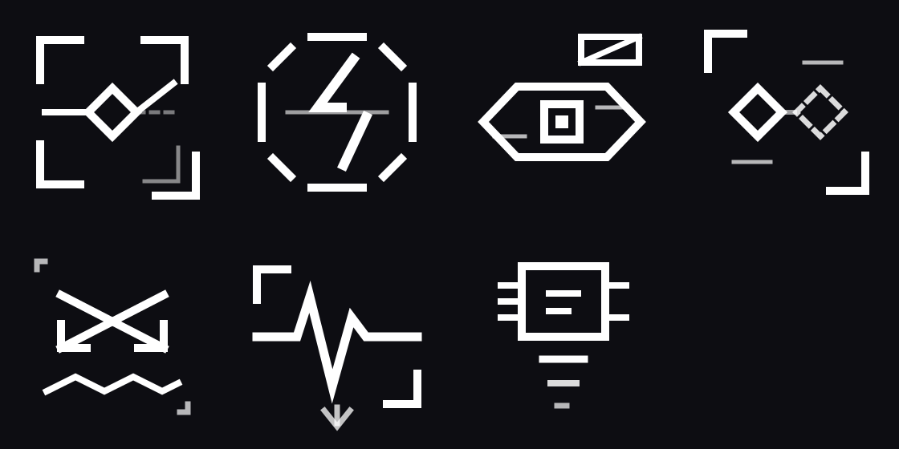

# NCQuickhacks — Anti-Cyberware & Tech Sabotage

[](https://www.cyberpunk.net/)
[](https://github.com/psiberx)
[](#project-status)
[](#localization--languages)
[](LICENSE)

Seven custom quickhacks for *Cyberpunk 2077* engineered to attack hostile chrome rather than organic flesh. From scramblers that cause smart weapons to miss and allies to draw friendly fire, to kinetic reflex traps that punish Sandevistan and Kerenzikov users, to neural crypto-siphons that bleed eurodollars straight out of enemy wetware.



---

## Project Status

> [!WARNING]
> **Work In Progress (WIP) — Active Development Currently Paused / On Hold**
> 
> This repository contains a fully authored, compiler-verified, and statically checked mod codebase. All redscript files compile cleanly against Cyberpunk 2077 script bundles, all TweakDB YAML records resolve their references, custom UI vector icons and inkatlas textures are fully packaged into `NCQuickhacks.archive`, and full dual-language strings (English & Ukrainian) are mapped via ArchiveXL.
> 
> However, active development and in-game behavioral balance iteration under live combat conditions are currently on hold. It is provided here as an open-source release snapshot, complete mod package, and technical reference for advanced Cyberpunk 2077 modding.

---

## Quick Reference & Stats

All seven quickhacks are Legendary-tier utility, control, and tech-sabotage programs.

| Quickhack | RAM | Upload | Duration | Category | In-Game Price | CET Code |
|:---|:---:|:---:|:---:|:---:|:---:|:---|
| **Crypto-Siphon** | 6 | 2.0s | 30s | Covert | €$4,000 | `Items.NCQ_CryptoSiphonProgram` |
| **Smart-Link Scramble** | 8 | 2.0s | 10s | Covert | €$7,000 | `Items.NCQ_SmartLinkScrambleProgram` |
| **Motor Cortex Inversion** | 9 | 2.0s | 10s | Control | €$8,000 | `Items.NCQ_MotorCortexInversionProgram` |
| **Reflex Booster Jammer** | 10 | 2.5s | 12s *(trap)* | Damage | €$11,000 | `Items.NCQ_ReflexJammerProgram` |
| **Phantom Overlay** | 10 | 2.5s | 12s | Covert | €$10,000 | `Items.NCQ_PhantomOverlayProgram` |
| **Optic Overwrite** | 12 | 3.0s | 15s | Control | €$15,000 | `Items.NCQ_OpticOverwriteProgram` |
| **Adrenaline Overdose** | 14 | 3.0s | 15s | Damage | €$18,000 | `Items.NCQ_AdrenalineOverdoseProgram` |

---

## Table of Contents

- [Project Status](#project-status)
- [Quick Reference & Stats](#quick-reference--stats)
- [Detailed Quickhack Breakdown](#detailed-quickhack-breakdown)
  - [1. Smart-Link Scramble](#1-smart-link-scramble)
  - [2. Reflex Booster Jammer](#2-reflex-booster-jammer)
  - [3. Optic Overwrite](#3-optic-overwrite)
  - [4. Phantom Overlay](#4-phantom-overlay)
  - [5. Motor Cortex Inversion](#5-motor-cortex-inversion)
  - [6. Adrenaline Overdose](#6-adrenaline-overdose)
  - [7. Crypto-Siphon](#7-crypto-siphon)
- [Requirements & Dependencies](#requirements--dependencies)
- [Installation Guide](#installation-guide)
  - [Manual Installation](#manual-installation)
  - [Automated / Linux / Wine Script Installation](#automated--linux--wine-script-installation)
  - [Uninstallation](#uninstallation)
- [Where to Obtain In-Game](#where-to-obtain-in-game)
  - [1. Netrunner Vendors & Ripperdocs](#1-netrunner-vendors--ripperdocs)
  - [2. Virtual Atelier Storefront](#2-virtual-atelier-storefront)
  - [3. World Loot & Enemies](#3-world-loot--enemies)
  - [4. Cyber Engine Tweaks (CET) Console](#4-cyber-engine-tweaks-cet-console)
- [Mod Compatibility & Synergies](#mod-compatibility--synergies)
- [Localization & Languages](#localization--languages)
- [Custom UI Icons & Asset Pipeline](#custom-ui-icons--asset-pipeline)
- [Architecture & Verification Notes](#architecture--verification-notes)
- [License](#license)

---

## Detailed Quickhack Breakdown

### 1. Smart-Link Scramble
- **Category:** Covert | **RAM:** 8 | **Upload:** 2.0s | **Duration:** 10s
- **Tactical Role:** Disrupt smart-weapon tracking and trigger asymmetric friendly fire.
- **Mechanisms:**
  - **Lock Break:** Applies a flat `-0.9` accuracy penalty (`BaseStats.Accuracy`), causing smart projectiles to lose guidance locks and spray erratically.
  - **One-Way Retarget:** Finds the nearest hostile squadmate within 25 meters and sets the target hostile toward them *one way only*. The target re-acquires and shoots at their teammate; the teammate does not return fire because their attitude toward the target is untouched.
  - **Design note:** This is confusion, not an open firefight (for an actual gunfight, use Optic Overwrite). If no squadmate is in range, the accuracy collapse still takes full effect.

### 2. Reflex Booster Jammer
- **Category:** Damage | **RAM:** 10 | **Upload:** 2.5s | **Duration:** 12s *(Trap)*
- **Tactical Role:** Hard counter and anti-elite punish for Sandevistan, Kerenzikov, and combat-dodging enemies.
- **Mechanisms:**
  - `BaseStatusEffect.NCQ_ReflexJammer` is an **inert trap**. Nothing happens until the enemy attempts to engage reflex cyberware.
  - Hooks directly into `AISubActionApplyTimeDilation_Record_Implementation.SetTimeDilation`, intercepting all NPC time dilation (Sandevistan, Kerenzikov, combat dodges).
  - When the enemy commits to reflex dilation:
    1. Removes the trap (single-shot to prevent runaway chain reactions).
    2. Returns `false` — **the time dilation is completely aborted**.
    3. Inflicts `BaseStatusEffect.Stun` — freezes them mid-animation.
    4. Inflicts `NCQ_ReflexMisfire` — applies `-10,000` Armor for 6 seconds (shreds all armor).
    5. Applies `BaseStatusEffect.Electrocuted` for visual arc effects and DoT.
    6. Deals a burst shock damage of `max(150, 20% of maximum health)`.
  - Against an unaugmented enemy with no reflex cyberware, the trap expires harmlessly.

### 3. Optic Overwrite
- **Category:** Control | **RAM:** 12 | **Upload:** 3.0s | **Duration:** 15s
- **Tactical Role:** Squad IFF spoof triggering full bilateral infighting.
- **Mechanisms:**
  - Calls `SetAttitudeGroupUnsavable(n"militech")` on the target to rewrite their broadcasted IFF signature. Using **Unsavable** is critical: the attitude override cannot be committed to save files, preventing permanent faction attitude corruption across reloads.
  - Up to 8 hostiles within 30 meters have their attitude towards the target set to hostile, and the target's attitude towards each of them set to hostile — **mutual bilateral hostility**, inciting a full shootout.
  - The player is never marked as a hostile participant, allowing stealth observation from cover.
  - On duration expiry, death, or cure, `OnStatusEffectRemoved` cleanly restores all original attitude groups.

### 4. Phantom Overlay
- **Category:** Covert | **RAM:** 10 | **Upload:** 2.5s | **Duration:** 12s
- **Tactical Role:** Force entire squad formations to break cover and scatter away from the player.
- **Mechanisms:**
  - Rather than spawning heavy entity decoys, Phantom Overlay designates the squadmate *furthest from the player* as a dynamic spatial anchor.
  - Pulses `gamedataStimType.SoundDistraction` from that anchor to the target and squad every 1.5 seconds.
  - Hostile squads break formation, abandon their firing lanes, and converge on the distraction point away from the player.

### 5. Motor Cortex Inversion
- **Category:** Control | **RAM:** 9 | **Upload:** 2.0s | **Duration:** 10s
- **Tactical Role:** Severe kinetic desynchronization and combat debuff.
- **Mechanisms:**
  - Because NPC navigation uses behavior trees rather than raw input axes, true joystick inversion has no engine hook.
  - Instead, applies individual temporal desynchronization: `SetIndividualTimeDilation(n"NCQMotorCortex", 0.55)` making their movement jerky and unresponsive.
  - The accompanying status effect drops `Accuracy` (−0.85), `AttackSpeed` (−0.6), and `Armor` (−200), neutralizing heavy gunners into slow liabilities.

### 6. Adrenaline Overdose
- **Category:** Damage | **RAM:** 14 | **Upload:** 3.0s | **Duration:** 15s
- **Tactical Role:** Forced metabolic cyberpsychosis followed by terminal physical collapse.
- **Mechanisms:**
  - Injects `BaseStatusEffect.MasterOfPuppets` cyberpsychosis, forcing the target to abandon cover and indiscriminately engage anything in line of sight.
  - Ticks a metabolic drain of 3.5% maximum health every second across the 15-second duration.
  - **Adrenaline Crash:** When the effect terminates, `NCQ_AdrenalineCrash` cripples the survivor with `-10,000` Armor and `-0.95` Accuracy for 8 seconds, leaving them helpless for an execution finisher.

### 7. Crypto-Siphon
- **Category:** Covert | **RAM:** 6 | **Upload:** 2.0s | **Duration:** 30s
- **Tactical Role:** Direct wealth extraction from enemy neural caches.
- **Mechanisms:**
  - Continuously siphons 12–30 Eurodollars (€$) per second directly into the player's wallet while resident.
  - **Kill Bounty:** Eliminating the target while the hack is active triggers a jackpot payout:
    $$\text{Payout} = 1500 + 4 \times (\text{Total Eddies Siphoned})$$
  - Clean detection without extra death hooks: uses `NPCPuppet.OnStatusEffectRemoved` and checks `!ScriptedPuppet.IsActive` to distinguish corpse loot from natural expiration.

---

## Requirements & Dependencies

### Core Dependencies (Required)
To run NCQuickhacks, ensure you have the following installed in your Cyberpunk 2077 game directory:

| Dependency | Minimum Version | Description |
|:---|:---|:---|
| **Cyberpunk 2077** | v2.0+ / v2.1+ | Base game (Phantom Liberty compatible) |
| [**RED4ext**](https://github.com/WopsS/RED4ext) | v1.25.0+ | Script extender and native mod loader |
| [**redscript**](https://github.com/jac3km4/redscript) | v0.5.18+ | Swift-like script compiler for Cyberpunk |
| [**ArchiveXL**](https://github.com/psiberx/cp2077-archive-xl) | v1.14.0+ | Extended resource and localization loader |
| [**TweakXL**](https://github.com/psiberx/cp2077-tweak-xl) | v1.10.4+ | TweakDB record modification framework |

### Optional Enhancements
- [**Virtual Atelier**](https://www.nexusmods.com/cyberpunk2077/mods/2987): Unlocks the dedicated "Night City Quickhacks" in-game computer storefront.
- [**Quickhack Weapon Mods**](https://www.nexusmods.com/cyberpunk2077/mods/24568): Adds all 7 quickhacks as craftable/lootable ranged weapon mods that trigger on hit.
- [**Cyber Engine Tweaks (CET)**](https://github.com/maximebf/CyberEngineTweaks): Provides the in-game debug console to grant quickhacks directly.

---

## Installation Guide

### Manual Installation
1. Download `NCQuickhacks-v0.1.0-wip.zip` from the [Latest Release](https://github.com/0xra0/NCQuickhacks/releases).
2. Extract the archive into your Cyberpunk 2077 installation folder (e.g. `C:\Games\Cyberpunk 2077\` or `steamapps/common/Cyberpunk 2077/`).
3. Verify that the files match this directory structure:
   ```text
   Cyberpunk 2077/
   ├── archive/
   │   └── pc/
   │       └── mod/
   │           ├── NCQuickhacks.archive
   │           └── NCQuickhacks.archive.xl
   └── r6/
       ├── scripts/
       │   └── NCQuickhacks/
       │       ├── NCQuickhacks.reds
       │       ├── NCQuickhacks2.reds
       │       └── NCQuickhacks_atelier.reds     <-- (Requires Virtual Atelier)
       └── tweaks/
           └── NCQuickhacks/
               ├── NCQuickhacks.yaml
               ├── NCQuickhacks2.yaml
               ├── NCQuickhacks_characters.yaml
               ├── NCQuickhacks_loot.yaml
               ├── NCQuickhacks_vendors.yaml
               └── NCQuickhacks_weaponmods.yaml  <-- (Requires Quickhack Weapon Mods)
   ```

> [!IMPORTANT]
> **Handling Optional Modules:**
> - **If you do NOT use Virtual Atelier:** Delete `r6/scripts/NCQuickhacks/NCQuickhacks_atelier.reds`. If left in place without Virtual Atelier installed, redscript will abort the compilation of all mods.
> - **If you do NOT use Quickhack Weapon Mods:** Delete `r6/tweaks/NCQuickhacks/NCQuickhacks_weaponmods.yaml` to avoid benign warnings about missing base records in TweakXL logs.

---

### Automated / Linux / Wine Script Installation

For Linux, Steam Deck, or developer environments running Cyberpunk under Wine/Proton, use the provided `install.sh` script:

```bash
# Set path to your Cyberpunk 2077 root directory if non-standard:
export GAME="/path/to/Cyberpunk 2077"

# Run the installer:
./install.sh
```

What `install.sh` does automatically:
1. **Detects Virtual Atelier:** Only stages and installs `NCQuickhacks_atelier.reds` if `VirtualShopRegistration` exists in your scripts.
2. **Detects Quickhack Weapon Mods:** Only stages `NCQuickhacks_weaponmods.yaml` if that mod is present.
3. **Pre-flight Linting:** Invokes `redscript-cli` against your game's compiled bundle (`final.redscripts.modded` or `final.redscripts`) to ensure zero script errors before copying.
4. **Deploy:** Installs the verified scripts, YAML tweaks, `.archive`, and `.archive.xl` files cleanly.

---

### Uninstallation

#### Script Uninstallation:
```bash
./install.sh uninstall
```

#### Manual Uninstallation:
Delete the following files and folders:
- `r6/scripts/NCQuickhacks/`
- `r6/tweaks/NCQuickhacks/`
- `archive/pc/mod/NCQuickhacks.archive`
- `archive/pc/mod/NCQuickhacks.archive.xl`

---

## Where to Obtain In-Game

### 1. Netrunner Vendors & Ripperdocs
All seven quickhacks are registered as permanent vendor stock (`Vendors.Always_Present`) at eight key Netrunner vendors across Night City:

| Vendor Record ID | District / Location |
|:---|:---|
| `cz_con_netrunner_01` | Corpo Plaza, Downtown |
| `cz_stadium_netrunner_01` | Corpo Plaza, Stadium Market |
| `hey_rey_netrunner_01` | Heywood, Wellsprings / Reyes |
| `wat_kab_netrunner_01` | Watson, Kabuki |
| `wat_lch_netrunner_01` | Watson, Little China |
| `wbr_jpn_netrunner_01` | Westbrook, Japantown (Market) |
| `wbr_jpn_netrunner_02` | Westbrook, Japantown (Plaza) |
| `BlackMarketer_HUB` | Dogtown Black Market Fixer (Phantom Liberty) |

*Note: Vendor IDs were verified directly from raw game TweakDB dumps.*

---

### 2. Virtual Atelier Storefront
If [Virtual Atelier](https://www.nexusmods.com/cyberpunk2077/mods/2987) is installed, browse the dedicated **Night City Quickhacks** store on any net terminal or apartment computer:

```text
Night City Quickhacks Storefront:
  • Crypto-Siphon              €$ 4,000
  • Smart-Link Scramble         €$ 7,000
  • Motor Cortex Inversion      €$ 8,000
  • Phantom Overlay             €$10,000
  • Reflex Booster Jammer       €$11,000
  • Optic Overwrite             €$15,000
  • Adrenaline Overdose         €$18,000
```

---

### 3. World Loot & Enemies
All seven programs are injected into the vanilla legendary quickhack loot hierarchy (`NCQuickhacks_loot.yaml`):
- Dropped by high-tier Netrunner enemies (`Loot.<gang>NetrunnerNetrunnerT2`).
- Found in quickhack access point containers (`LootTables.QuickhackTable_Chance` & `LootTables.LegendaryQuickhacks`).
- Configured with vanilla drop rates (0.2 weight) and respects player character level gating.
- Uses `!append` directives, guaranteeing 100% compatibility with vanilla loot and other mods.

---

### 4. Cyber Engine Tweaks (CET) Console
To spawn any of the quickhacks instantly for testing, press your CET overlay hotkey (usually `~`) and run:

```lua
Game.AddToInventory("Items.NCQ_CryptoSiphonProgram")
Game.AddToInventory("Items.NCQ_SmartLinkScrambleProgram")
Game.AddToInventory("Items.NCQ_MotorCortexInversionProgram")
Game.AddToInventory("Items.NCQ_PhantomOverlayProgram")
Game.AddToInventory("Items.NCQ_ReflexJammerProgram")
Game.AddToInventory("Items.NCQ_OpticOverwriteProgram")
Game.AddToInventory("Items.NCQ_AdrenalineOverdoseProgram")
```

---

## Mod Compatibility & Synergies

- **Zero `@replaceMethod` Guarantee:**
  This mod does **not** replace any vanilla methods (`@replaceMethod`). All functionality is hooked strictly via `@wrapMethod`, `@addMethod`, and `@addField`. This ensures zero collision with popular mods like *CharmQuickhack*, *Cyberware-EX*, or overhaul mods.
- **Cyberdeck Slot Mods:**
  Fully compatible with mods like *Slots Slots Slots*. Programs are native `Prt_Program` items that respect all deck expansion logic.
- **Monowire Quickhack Slots:**
  All seven programs declare `AttachmentSlots.NanoWiresQuickhackSlot` in their `placementSlots`. You can slot any of the seven into your Monowire cyberware.
- **Quickhack Weapon Mods (Nexus 24568):**
  Includes `NCQuickhacks_weaponmods.yaml`, defining all 7 quickhacks across 5 rarity tiers (Common to Legendary) as ranged weapon mods with borrowed chance profiles (e.g. Smart-Link Scrambler on `WeaponGlitch` chance, Reflex Jammer on `CyberwareMalfunction` chance).

---

## Localization & Languages

All quickhack names, inventory cards, scanner wheel captions, and tooltip descriptions are localized via ArchiveXL (`NCQuickhacks.archive.xl`).

| Language | Code | Status |
|:---|:---:|:---|
| **English** | `en-us` | Complete |
| **Ukrainian** | `ua-ua` | Complete |
| *All Other Languages* | `*` | Fallback mapped to English (avoids blank labels) |

String generation is handled via `loc/build_locale.py`. TweakDB records use bare secondary CName keys (e.g. `NCQ_CryptoSiphon_name`) and LocKey strings (`LocKey#NCQ_CryptoSiphon_sedesc`) mapped cleanly through native engine hash lookup.

---

## Custom UI Icons & Asset Pipeline

Eight custom vector glyphs were drawn from scratch in SVG conforming to Cyberpunk 2077's UI design language (45° chamfered geometry, segment gaps, stroke ticks, miter joints):

| Quickhack / Asset | Visual Motif |
|:---|:---|
| **Smart-Link Scramble** | Deflected ballistic vector with dashed ghost path & offset lock brackets |
| **Reflex Booster Jammer** | Horizontally sheared dilation ring with severed lightning bolt |
| **Optic Overwrite** | Angular Kiroshi aperture with struck-through IFF tag |
| **Phantom Overlay** | Dual offset silhouette brackets with a dashed phantom trace |
| **Motor Cortex Inversion** | Neural cortex geometry with reversed coordinate axes |
| **Adrenaline Overdose** | Injector needle spike superimposed on an erratic cardiac waveform |
| **Crypto-Siphon** | Eurodollar symbol tapped by an exfiltration data conduit |
| **Storefront Logo** | Chamfered cyberdeck terminal with exposed data bus pins |

The build toolchain converts SVG → PNG via `rsvg-convert`, then imports into XBM/inkAtlas textures packed with Oodle compression (`oo2ext_7_win64.dll`) into `NCQuickhacks.archive`.

---

## Architecture & Verification Notes

- **Lifecycle Without Synthetic Effectors:**
  Instead of fragile `gamedataEffector` chains, status effects hook directly into `NPCPuppet.OnStatusEffectApplied` and `NPCPuppet.OnStatusEffectRemoved`. The REDengine itself guarantees cleanup callbacks whether an effect expires, the NPC dies, or an effect is cleansed.
- **Bundle Verification:**
  All scripts have been linted against both vanilla `final.redscripts` and modded bundles `final.redscripts.modded` with zero errors.

---

## License

This project is licensed under the MIT License — see the [LICENSE](LICENSE) file for details.
All Cyberpunk 2077 assets and identifiers are property of CD PROJEKT RED.
